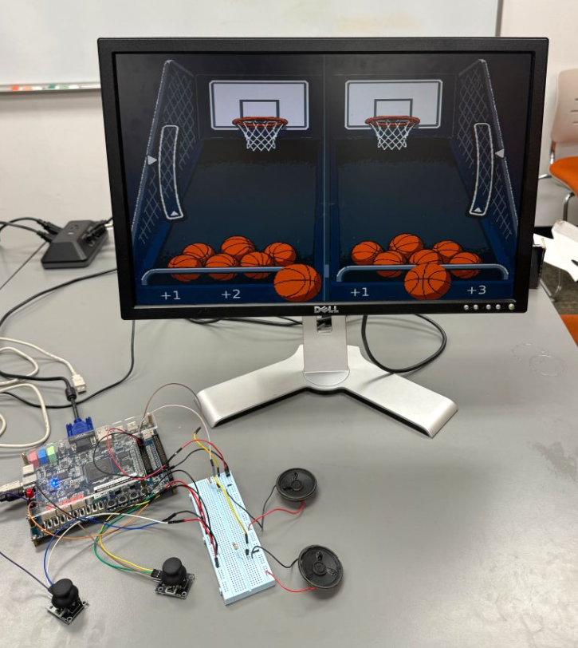
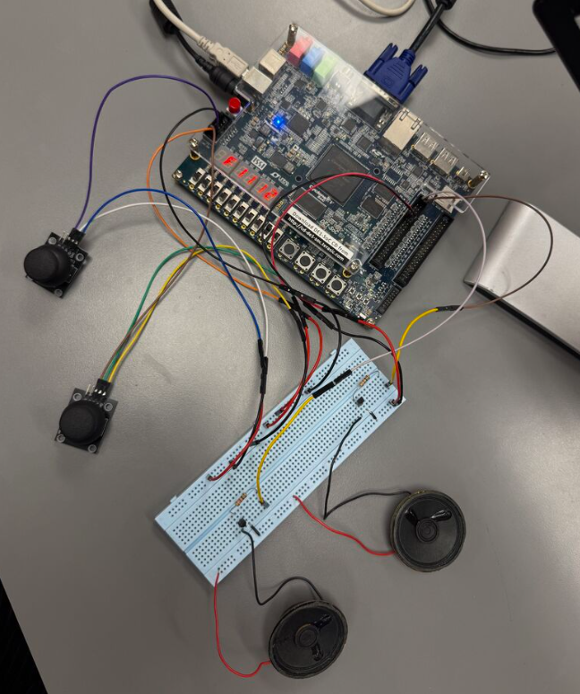
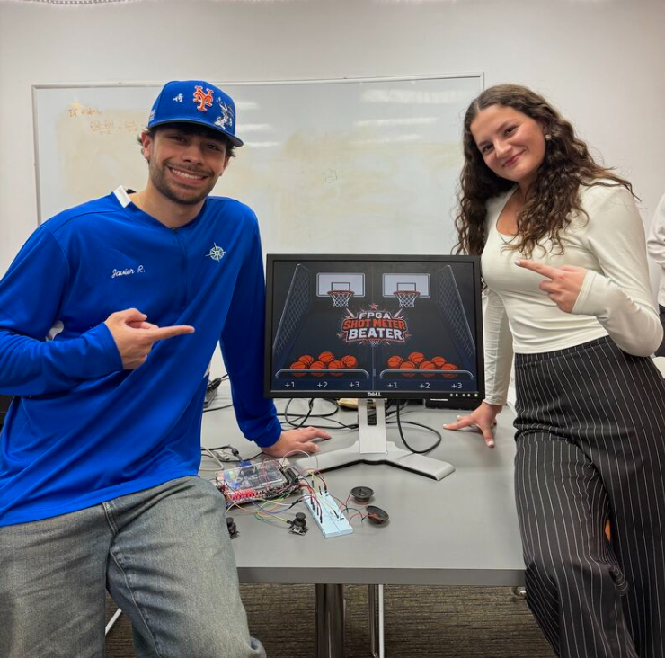

# Meter Beater — FPGA Basketball Arcade

A two-player basketball arcade game built in **SystemVerilog** on the **DE1-SoC FPGA board** for Digital Design II (Spring 2026).

Players use joysticks to choose a shooting position, then hold and release a button to time their shot. Each lane offers a different point value and timing difficulty.

### Features

- Two-player gameplay with independent shot meters, scoring, and shot limits.
- 640 × 480 VGA graphics with ROM-backed sprites and animated shot trajectories.
- Analog joystick input through a serial ADC controller.
- Audio effects, LED shot indicators, and seven-segment score displays.
- Separate gameplay and VGA clock domains, with synchronized events between them.

### Selected source files

The rtl/ folder contains three selected SystemVerilog samples:

- **control.sv:** Game state machine for ready, playing, and finished states.
- **shot_result_controller.sv:** Shot evaluation and delayed scoring after animation completes.
- **vga_game_sync.sv:** Synchronization of gameplay signals and events into the VGA clock domain.

One integration challenge was ensuring the final shot's score committed before the game ended. The game-over logic waits for active shots and pending score updates to finish before triggering the final result.

This repository is a **selected-source portfolio showcase**, not a complete Quartus build. Additional modules, ROM/MIF assets, generated IP, and board constraints are required to rebuild the full project.

### Hardware and team

**Team:** Myriam Bajani and Javier Ralat · **Tools:** Intel Quartus Prime, SystemVerilog
